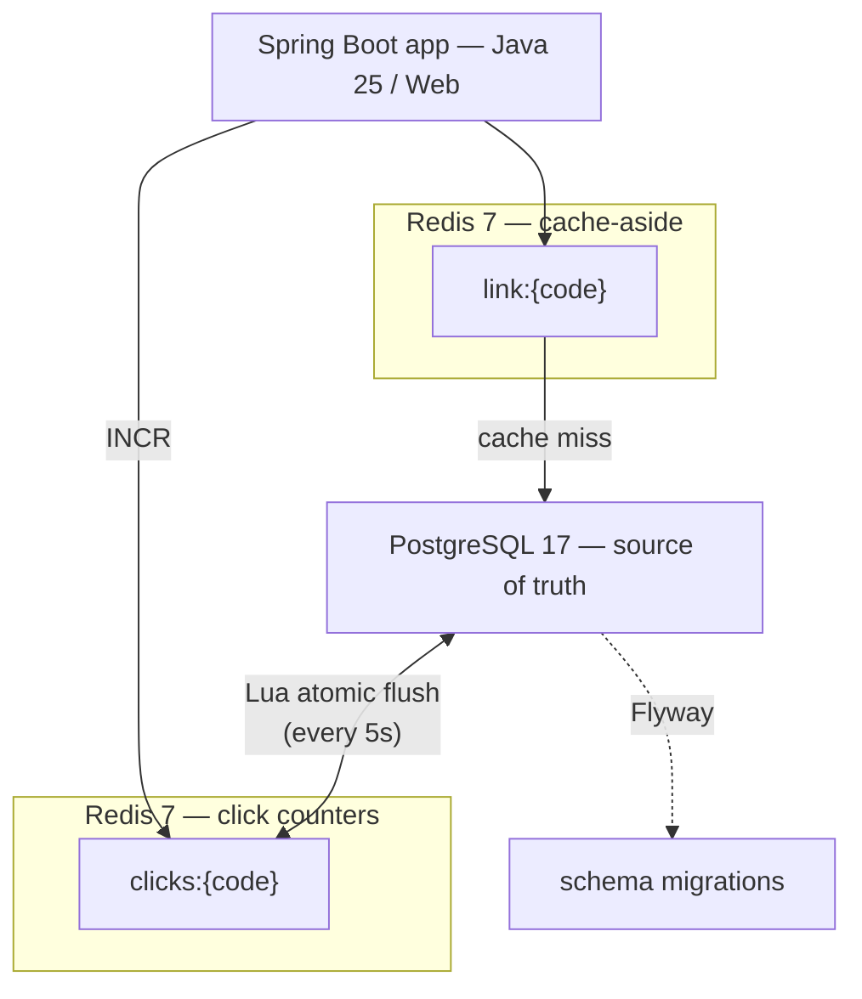
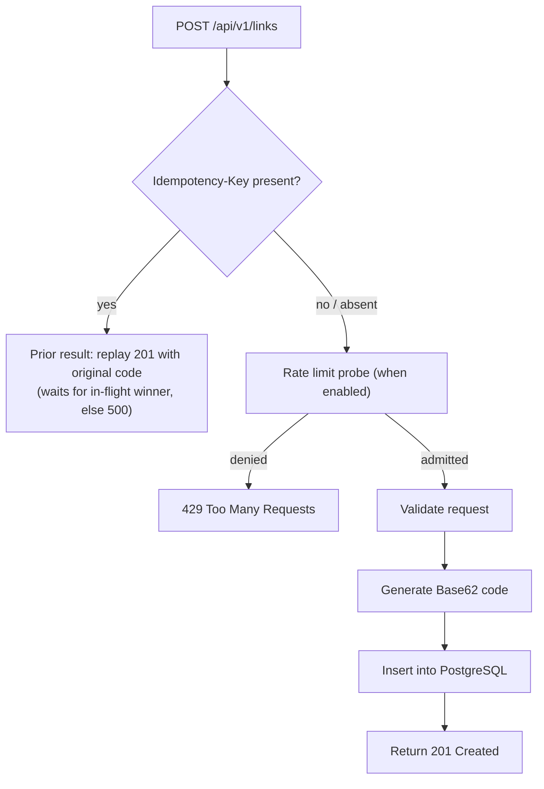
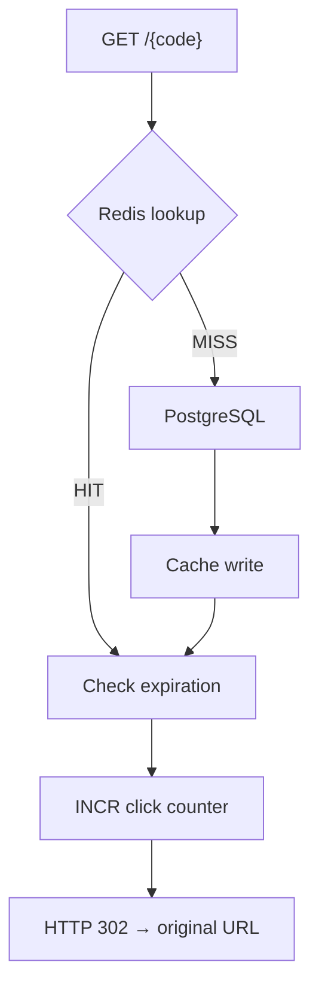
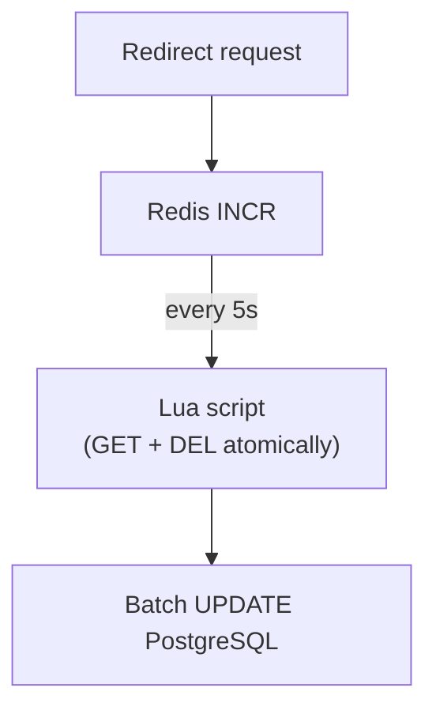
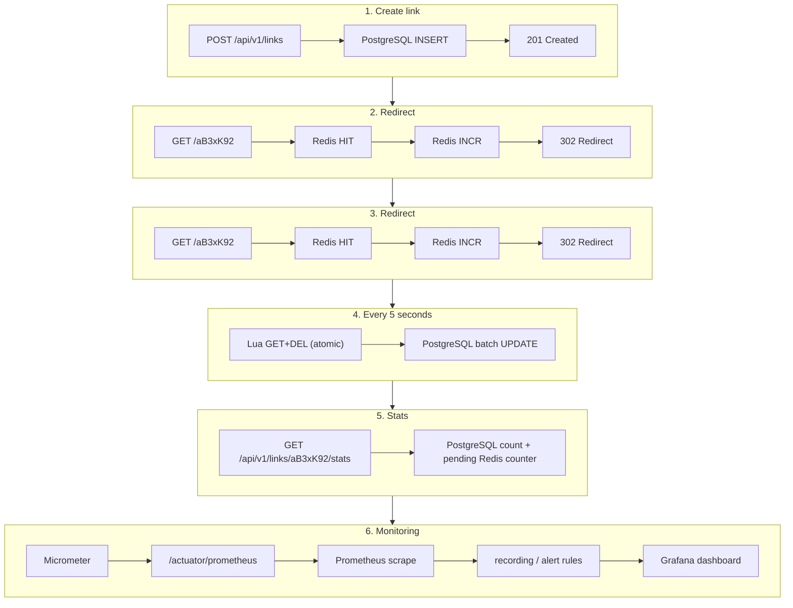

# URL Shortener

A production-oriented URL shortening service built with **Spring Boot 4.1.1**, **Java 25**, **PostgreSQL 17**, and **Redis 7**.

The service uses PostgreSQL as the source of truth, Redis for low-latency redirects and click buffering, Flyway for schema migrations, and Testcontainers for realistic integration testing.


## ✨ Features

- **URL shortening** with a random 7-character Base62 code (configurable via `SHORTENER_CODE_LENGTH`).
- **Case-insensitive codes**: `GET /AbC1234` resolves the same link as `abc1234`.
- **Custom aliases**, for example `/my-link`.
- **Link expiration (TTL)** with `expiresAt`.
- **Cache-aside redirects**: hot links are served from Redis without a PostgreSQL query; the cached value carries `expiresAt`, so expiry is always re-checked on a hit.
- **Click buffering in Redis** with atomic `INCR`, flushed to PostgreSQL every 5 seconds by a Lua script (`GET`+`DEL` atomic — no lost increments).
- **Stats without flush lag**: `clickCount` = persisted PostgreSQL count + pending Redis counter.
- **Distributed click flush**: the `@Scheduled` flush is serialized across instances with ShedLock (a PostgreSQL `shedlock` table) so a multi-pod deployment drains Redis exactly once per interval, not once per replica.
- **Graceful infrastructure degradation**: a PostgreSQL outage answers create/miss lookups with a fast `503` (bounded by a 5 s pool timeout) while Redis cache hits keep redirecting; a failed flush restores counters instead of losing clicks.
- **Request size limit**: oversized bodies are rejected with `413` before parsing.
- **Create-endpoint rate limiting** (Task 20.4): a key-scoped, Redis-backed fixed-window limiter (`shortener.rate-limiter`) protects `/api/v1/links` from abuse, answering `429 Too Many Requests` (`retryAfter: 1`) when the limit is exceeded. Disabled by default (`enabled: false`) so existing high-volume suites stay green; a Redis outage fails open so a create request is never lost to a transient outage.
- **Idempotent create** via an optional `Idempotency-Key` header: a create retried after an HTTP timeout with the same key replays the original `201` with the original `code` instead of creating a second link, so a timeout can no longer duplicate a link for the same URL. The prior result is stored in Redis (~24h TTL).
- **RFC 9457 error responses** based on Spring's `ProblemDetail`.
- **OpenAPI 3 documentation** with interactive Swagger UI.
- **Java virtual threads** enabled through a single Spring Boot property.
- **Integration testing with Testcontainers** against real PostgreSQL and Redis, including live failure injection (stopping the real containers).
- **One-command local startup** using Docker Compose.

## 🛠 Tech Stack

| Layer | Technology |
|---|---|
| Language | Java 25 |
| Framework | Spring Boot 4.1.1 |
| Web | Spring Web |
| Persistence | Spring Data JPA + Hibernate |
| Database | PostgreSQL 17 |
| Migrations | Flyway |
| Cache & counters | Redis 7 + Spring Data Redis |
| Atomic operations | Redis Lua scripts |
| API documentation | springdoc-openapi + Swagger UI |
| Testing | JUnit 5, Testcontainers, Awaitility, AssertJ |
| Build | Gradle Kotlin DSL |
| CI | GitHub Actions |
| Runtime | Java virtual threads |
| Metrics | Micrometer + Spring Boot Actuator + Prometheus |
| Dashboards | Grafana |
| Monitoring configuration | Prometheus/Grafana configuration as code |

> **Versioning note:** pin exact dependency versions in Gradle and keep the README badge versions aligned with the actual build configuration.

### Virtual threads (Sprint 14)

Enabled via `spring.threads.virtual.enabled: true`. Verified by `VirtualThreadsIT`:

- HTTP request lifecycle — one virtual thread per request (Tomcat);
- `@Scheduled` click flush — runs on a virtual thread;
- a 60-way concurrent burst does not inflate the server platform thread count.

Blocking operations under virtual threads: JPA calls block on a Hikari checkout
(pool pinned at **10** — cheap threads must not become a reason to widen the
pool, see `ConnectionPoolIT`); Redis calls park the virtual thread on Lettuce's
non-blocking Netty I/O.

Local benchmark (cache-hit redirect, dev laptop, Python thread-pool client —
`curl | xargs` was spawn-bound and useless above ~45 rps):

| Scenario (workers × requests) | OFF: throughput / avg / p95 | ON: throughput / avg / p95 |
|---|---|---|
| 100 × 2000 | 4453 rps / 21 ms / 36 ms | 3279 rps / 29 ms / 66 ms |
| 400 × 4000 | 4109 rps / 51 ms / 427 ms | 4217 rps / 50 ms / 420 ms |
| CPU, 200 × 6000 | 4.0 s total | 3.0 s total |

Memory at rest: ~337 MB (OFF) vs ~389 MB (ON, carrier + pinning arenas).
DB saturation: identical — 10/10 Hikari connections in both modes.

**Reading:** for the cache-hit redirect path both modes are within noise —
the ceiling is Redis, not threads. Virtual threads buy headroom above the
platform-thread limit without tuning `server.tomcat.threads.max`, at ~50 MB
extra RSS. The PostgreSQL pool stays the hard concurrency ceiling for DB
access in both modes.

### Performance baseline (Sprint 23, re-measured 2026-10-01)

Measured with k6 (scripts in `benchmarks/`) against the dev stack on a
desktop machine — an anchor for future comparisons, not an absolute claim.
All runs: **0% errors**.

> **Harness fix (2026-10-01):** the `miss` scenario originally cycled the
> same pool codes per VU, so most "miss" requests were served from Redis —
> the Sprint 23 miss row (~3 210 rps) was contaminated. The scenario now
> uses `shared-iterations` with a global counter: every request is a
> genuine PostgreSQL lookup. The numbers below are re-measured with the
> fixed harness.

Per-endpoint (30 s each; `miss` is pool-bound — 30 000 unique codes in ~6 s):

| Scenario | RPS | avg | p95 | Notes |
|---|---|---|---|---|
| Redirect — Redis hit | ~16 887 | 2.8 ms | 4.8 ms | 506 637 requests |
| Redirect — PostgreSQL miss | ~4 737 | 6.1 ms | 9.6 ms | 30 000 requests, 30 000-code uncached pool |
| Create link | ~1 486 | 20.0 ms | 29.2 ms | write path + Hikari checkout |
| Stats | ~9 651 | 5.1 ms | 8.0 ms | PostgreSQL read + pending counter |
| Delete | ~727 pairs/s | 13.6 ms | 17.6 ms | 21 850 create + delete pairs |
| 10 000 concurrent redirects | ~2 999 | 0.81 ms | 1.6 ms | 12 001 requests / 4 s, 0 dropped |

Full load profile (warm-up → sustained → 500-VU spike → cool-down,
4 min): **4 322 597 requests**, 18 010 rps avg, p95 18.96 ms, 0 failures.
Resource ceilings observed during the profile: CPU ≈ 3.8 cores avg /
4.0 cores peak; RSS ≈ 601 MB avg / 736 MB peak; PostgreSQL connections
saturated the 10-connection pool at the spike (pending queue ≤ 91 —
virtual threads wait, they do not overwhelm the pool); PostgreSQL and
Redis each stayed ≤ 12 % CPU (72 MB / 17 MB RSS); Redis traffic
≈ 2 ops per redirect; zero flush or increment failures.

Flush interval comparison (60 s, 50 VUs, cache-hit redirect — measured with
the original Sprint 23 harness; the hit path was not affected by the miss
harness bug):

| `SHORTENER_FLUSH_INTERVAL` | Requests | p95 | Flushes/min |
|---|---|---|---|
| PT1S | 335 438 | 12.50 ms | 53 |
| PT5S (default) | 352 193 | 12.04 ms | 12 |
| PT10S | 342 727 | 12.46 ms | 6 |

Flush runs off the request path — redirect latency is identical within
noise at every interval; the interval only trades click-count freshness
against PostgreSQL write frequency. The **default stays PT5S**: sub-second
stats lag is not a stated requirement, and 5 s already bounds the loss
window (Sprint 8) at a quarter of the write load of PT1S.

Reproduce: `python benchmarks/prepare.py` then
`k6 run -e SCENARIO=<hit|miss|create|stats|delete|spike10k> benchmarks/k6-scenario.js`
or `k6 run benchmarks/k6-main.js` for the full profile. The `hit` path uses
the benchmark-only `GET /bench-hit` endpoint, enabled via
`SHORTENER_BENCHMARK_ENABLED=true` (default in the dev compose stack; off in
production).

> **Harness fix (2026-10-09):** `prepare.py` now resets the stack before
> every run — `TRUNCATE links` (the create/delete scenarios emit deterministic
> aliases `c-<id>-<iter>`, so a dirty DB makes them collide with prior runs'
> rows and k6 reports 409s that are *correct* app behaviour, not a
> regression) followed by `Redis FLUSHALL` for a cold-cache `miss`. Always
> run `prepare.py` before a fresh benchmark run.

### Database notes (Sprint 24)

**Query plans** (`EXPLAIN ANALYZE` on 200 000 links): all three hot queries
are unique-index scans, sub-millisecond — `findByCodeIgnoreCase` via the
`links_code_lower_uq` functional index (0.05 ms), click update and delete
via `links_pkey` (0.19 / 0.11 ms). `PRIMARY KEY(code)` plus the migration-V2
case-insensitive index cover every lookup; no additional indexes.

**Per-click vs batch flush** (10 000 clicks, one transaction, psql over
`docker exec`): 10 000 individual `UPDATE`s — 1.96 s; one batched `unnest`
`UPDATE` — 0.49 s (~4×), before counting the per-click network roundtrip
the batched flush removes from the redirect path entirely.

**Connection pool** (Hikari metrics sampled at 2 s under the heaviest DB
path, sustained cache-miss load, both runs 0% errors on valid 302s):
pool 10 → active avg 2.1, p95 12.6 ms, connection queueing observed
(pending up to 10); pool 16 → active avg 3.1, p95 13.1 ms, queueing gone
(pending ≤ 3) — **but no faster**. Connection waiting at pool 10 is not
what costs latency on the miss path; the PostgreSQL lookup and cache
repopulate dominate. **Pool stays at 10** (`ConnectionPoolIT` pins it) —
sized from measured concurrency, not from the virtual-thread count.

### Redis notes (Sprint 25)

**Key inspection (25.1):** `link:{code}` — JSON string, e.g. 84 bytes for a
typical entry; `clicks:{code}` — plain `INCR` counter string. Keys are
lowercased to stay consistent with the case-insensitive lookup index.

**TTL audit (25.2):** `link:` entries carry
`min(configured TTL, remaining business lifetime)` — verified live: 1 h for
long-lived links, a 3-second link's entry auto-removed right at expiry, and
`DELETE` evicts its entry immediately. `clicks:` counters intentionally have
**no TTL** — a counter must survive until the flush persists it; the drain
script deletes the key after a successful read, and a failed flush restores
the value (Task 17.3).

**Serialization (25.3), measured:** JSON vs a compact `code|url|epoch`
string — 152 vs 104 bytes per key (payload 84 vs 41). Throughput of 20 000
pipelined GETs was **identical** (0.237 s both) — GET is O(1) and does not
care about 43 bytes. **JSON stays**: the saving is ~48 bytes/key (~30 MB for
200 k cached links — trivial), while the compact format breaks the Sprint 19
forward-compatible wire contract, loses human-readable values in
`redis-cli`, and needs delimiter escaping (URLs can contain `|`).

**Lua drain (25.5), verified live:** one batch script drains up to
`BATCH_SIZE` (1000) keys per execution (`GET`+`DEL` atomic per key, all in
one Lua call), discovered by non-blocking `SCAN` (count 100) — no `KEYS`
scans, no unbounded key lists. Drains in `O(number of batches)`
round-trips, so it no longer scales with the number of hot links. 20
counters drained in one call: 0 errors, every counter returned its value,
0 keys left behind; draining a missing key returns `nil` (idempotent).
Error handling: a failed batch leaves those counters intact and the cycle
surfaces as `clicks.flush.failed` (`RedisFailureIT`). Batch size is
constructor-injectable (default 1000).

## 🏛 Architecture



### Monitoring flow (Sprint 29)

The monitoring pipeline is fully reproducible from Git and requires no manual
Prometheus or Grafana configuration:

```mermaid
flowchart TB
    app2["Spring Boot application"] --> actuator2["Spring Boot Actuator<br/>/actuator/prometheus"]
    actuator2 -.|"scrape"| prom2["Prometheus"]
    prom2 --> rec22["recording rules"]
    prom2 --> alert22["alert rules"]
    prom2 -.|"PromQL"| graf2["Grafana"]
    graf2 --> ds2["datasource provisioning"]
    graf2 --> dp2["dashboard provisioning"]
```

```text
Repository
└── monitoring/
    ├── prometheus/
    │   ├── prometheus.yml
    │   └── rules/
    │       ├── recording-rules.yml
    │       └── alert-rules.yml
    └── grafana/
        ├── dashboards/
        │   └── url-shortener-overview.json
        └── provisioning/
            ├── datasources/
            │   └── prometheus.yml
            └── dashboards/
                └── dashboards.yml
```

The repository version controls scrape configuration, rules, Grafana
datasource provisioning and dashboards. A clean local environment must
reproduce the monitoring setup from these files alone.

### Main request flows

#### Create link



When an `Idempotency-Key` header is present the whole create is wrapped in the `IdempotencyStore`
— the first request that carries a key owns it, runs the create, and stores the result in Redis (~24h
TTL); a retried request with the same key replays that original `201` (same `code`) instead of running
the create again, so it consumes no rate-limit budget and performs no insert. A request whose key is
owned by an in-flight request waits up to `SHORTENER_IDEMPOTENCY_WAIT_TIMEOUT` (5 s) for the winner,
then fails `500` if the owner never finishes. When the header is absent or blank the create runs
directly.

The `RateLimiter` probe is the first gate in `WriteLinkService.create`: a denied
probe answers `429` (`retryAfter: 1`) without touching PostgreSQL or Redis.
When the limiter is disabled (the default) it admits everything.

The database `UNIQUE` constraint is the final protection against code collisions. An optimistic `existsByCode(...)` check may reduce avoidable database conflicts, but it is not sufficient for concurrency by itself.

#### Redirect



The cached representation contains `expiresAt`, so an expired link is not accidentally served just because its Redis entry has not yet expired.

#### Click counter flush



The Lua script prevents the classic read-then-delete race where increments
arriving between the two commands can be lost. The flush discovers counters
by non-blocking `SCAN` (never `KEYS`) and batches the persistence as one
`unnest` `UPDATE` — measured ~4× faster than per-click updates.

## 📁 Project Structure

```text
src/main/java/com/javaded78/urlshorter/
├── api/
│   ├── controller/       # REST endpoints (thin: validate → service → DTO)
│   ├── dto/              # request/response DTOs
│   └── error/            # ProblemDetail / exception handling
│
├── domain/
│   ├── model/            # domain objects (no Redis/JPA specifics)
│   ├── cache/            # cache port: CachedLink (stable wire format) + LinkCache
│   ├── counter/          # counter port: ClickCounter (no Redis types in signatures)
│   ├── repository/       # pure persistence port (domain interface; no Spring Data/JPA)
│   ├── config/           # pure domain config records (bridged from ShortenerProperties)
│   ├── service/          # application/domain services
│   ├── exception/        # @ControllerAdvice-driven errors (sealed hierarchy)
│   └── validation/       # input validators (AliasValidator, UrlValidator)
│
├── infra/
│   ├── encoding/         # Base62Codec + Base62CodeGenerator (implements domain.service.CodeGenerator)
│   ├── http/             # IP/CIDR matching + IP-based create-rate-limit source (ADR-009)
│   ├── persistence/      # JPA entity, JpaLinkRepository + LinkJpaRepository (Spring Data)
│   └── redis/
│       ├── cache/        # Redis cache implementation (RedisLinkCache)
│       ├── counter/      # Redis click counters (RedisClickCounter)
│       ├── script/       # Lua scripts
│       ├── flush/        # ClickFlushJob (scheduler) + CounterFlushService (flush orchestrator)
│       ├── limiter/      # Redis-backed fixed-window rate limiter
│       └── idempotency/  # RedisIdempotencyStore (Idempotency-Key result replay)
│
├── config/               # properties, filters, validation constraints, OpenAPI, scheduling/auditing, startup diagnostics
└── (application classes end here)

monitoring/                # repo-root Prometheus/Grafana configuration as code
├── prometheus/
│   ├── prometheus.yml
│   └── rules/
│       ├── recording-rules.yml
│       └── alert-rules.yml
└── grafana/
    ├── dashboards/
    │   └── url-shortener-overview.json
    └── provisioning/
        ├── datasources/
        │   └── prometheus.yml
        └── dashboards/
            └── dashboards.yml
```

The service layer talks to Redis only through the `domain/cache` and
`domain/counter` ports — never through Redis command details. The
`domain/repository` port is a pure domain interface (no Spring Data, JPA, or
`LinkEntity`); the JPA boundary lives in `infra.persistence` as
`JpaLinkRepository` (a thin adapter) over the Spring Data
`LinkJpaRepository`, where `LinkEntity`, JPQL and `@Modifying` all belong.
`@Transactional` boundaries live on the use-case owners — `WriteLinkService`
(domain) and the `CounterFlushService` flush orchestrator (infra) — not on the
repository.

## 🚀 Quick Start

The easiest way to start the entire stack is Docker Compose.

### Prerequisites

- Docker
- Docker Compose
- Git

### Start

```bash
git clone https://github.com/your-username/url-shortener.git
cd url-shortener

docker compose up --build
```

The local stack includes the application, PostgreSQL, Redis, Prometheus and Grafana.

The application will be available at:

- **Swagger UI:** http://localhost:8080/swagger-ui.html
- **Health:** http://localhost:8080/actuator/health
- **Prometheus metrics:** http://localhost:8080/actuator/prometheus

Prometheus and Grafana are provisioned automatically by Docker Compose. Their
host ports are defined in `docker-compose.yml`; no manual datasource or
dashboard setup is required.

## 💻 Local Development

For local development, run PostgreSQL and Redis in Docker and the Spring Boot application from your IDE or Gradle.

```bash
docker compose -f docker-compose.dev.yml up -d

./gradlew bootRun
```

Or start the application directly from the IDE.

Flyway migrations are applied automatically during application startup.

See [DEVELOPMENT.md](DEVELOPMENT.md) for the full developer guide (IDE
setup, debugging, Redis/PostgreSQL inspection, common failures, benchmarks).

## 📡 API

The management API is versioned by URL path: the current major version is
`/api/v1`. Breaking contract changes ship under a new prefix (`/api/v2`),
keeping `/api/v1` stable for existing clients. The public redirect endpoint
`GET /{code}` is intentionally not versioned — it is the entry point short
links are created for, and path versioning there would only make shared
codes longer.

| Method | Path | Description | Success / Error Codes |
|---|---|---|---|
| `POST` | `/api/v1/links` | Create a short link | `201`, `400`, `409`, `429` |
| `GET` | `/{code}` | Redirect to the original URL | `302`, `404`, `410` |
| `GET` | `/api/v1/links/{code}` | Get link details | `200`, `404` |
| `GET` | `/api/v1/links/{code}/stats` | Get click statistics | `200`, `404` |
| `DELETE` | `/api/v1/links/{code}` | Delete a link | `204`, `404` |

### Create a link

```bash
curl -X POST http://localhost:8080/api/v1/links \
  -H "Content-Type: application/json" \
  -d '{
    "originalUrl": "https://example.com/very/long/path",
    "expiresAt": "2026-12-31T23:59:59Z"
  }'
```

Response `201 Created`:

```json
{
  "code": "aB3xK92",
  "originalUrl": "https://example.com/very/long/path",
  "expiresAt": "2026-12-31T23:59:59Z",
  "clickCount": 0,
  "createdAt": "2026-01-15T10:15:30Z"
}
```

`expiresAt` is optional — omit it (or pass `null`) for a link that never
expires. A custom alias can be requested with `"alias": "my-link"`;
`code` in the response is the alias. Codes are case-insensitive.

### Idempotent create (Idempotency-Key)

Send the optional `Idempotency-Key` header to make a create idempotent:

```bash
curl -X POST http://localhost:8080/api/v1/links \
  -H "Idempotency-Key: 3f2504e0-4f89-41d3-9607-1ed3f0b3963d" \
  -H "Content-Type: application/json" \
  -d '{"originalUrl": "https://example.com"}'
```

A retried create with the same key (for example after an HTTP timeout) replays the
original `201 Created` with the original `code` instead of creating a second link.
The result is stored in Redis with a ~24h TTL (`SHORTENER_IDEMPOTENCY_TTL`); a
create whose key is owned by an in-flight request waits up to
`SHORTENER_IDEMPOTENCY_WAIT_TIMEOUT` (`5s`), then fails as `500` if the owner never
finishes. Omit the header for a normal, non-idempotent create.

Error cases:

```json
// 400 — invalid URL or malformed request (detail carries the validator message)
{
  "type": "https://urlshortener.javaded78.dev/errors/validation-error",
  "title": "Invalid request",
  "status": 400,
  "detail": "URL scheme must be one of [http, https]: ftp://example.com",
  "instance": "/api/v1/links"
}
```

```json
// 409 — generated code collision after bounded retries, or alias taken
{
  "type": "https://urlshortener.javaded78.dev/errors/code-already-taken",
  "title": "Code already taken",
  "status": 409,
  "detail": "code already taken: my-link",
  "instance": "/api/v1/links"
}
```

```json
// 413 — request body over the configured limit (default 16 KB)
{
  "type": "https://urlshortener.javaded78.dev/errors/payload-too-large",
  "title": "Payload too large",
  "status": 413,
  "detail": "request body exceeds the maximum of 16384 bytes",
  "instance": "/api/v1/links"
}
```

```json
// 503 — PostgreSQL unavailable (bounded by a 5 s pool timeout)
{
  "type": "https://urlshortener.javaded78.dev/errors/database-unavailable",
  "title": "Service unavailable",
  "status": 503,
  "detail": "database temporarily unavailable",
  "instance": "/api/v1/links"
}
```

```json
// 429 — create-endpoint rate limit exceeded (429 Too Many Requests)
// Only when the limiter is enabled via `shortener.rate-limiter.enabled`
// (disabled by default). `retryAfter` is a hint, in seconds.
{
  "type": "https://urlshortener.javaded78.dev/errors/rate-limited",
  "title": "Too many requests",
  "status": 429,
  "detail": "rate limit exceeded",
  "retryAfter": 1,
  "instance": "/api/v1/links"
}
```

### Redirect

```bash
curl -i http://localhost:8080/aB3xK92
```

Expected response:

```http
HTTP/1.1 302 Found
Location: https://example.com/very/long/path
```

Error cases:

```json
// 404 — unknown code
{
  "type": "https://urlshortener.javaded78.dev/errors/link-not-found",
  "title": "Link not found",
  "status": 404,
  "detail": "link not found: aB3xK92",
  "instance": "/aB3xK92"
}
```

```json
// 410 — link existed but expired (also on cache hit; expiry is re-checked)
{
  "type": "https://urlshortener.javaded78.dev/errors/link-expired",
  "title": "Link expired",
  "status": 410,
  "detail": "link expired: aB3xK92",
  "instance": "/aB3xK92"
}
```

### Get link details

```bash
curl http://localhost:8080/api/v1/links/aB3xK92
```

Response `200 OK` — same `LinkResponse` shape as create. Error case:
`404` with the same ProblemDetail shape as the redirect's 404.

### Statistics

```bash
curl http://localhost:8080/api/v1/links/aB3xK92/stats
```

Example response:

```json
{
  "code": "aB3xK92",
  "clickCount": 42
}
```

`clickCount` is the persisted PostgreSQL count plus clicks still pending in
Redis, so it is current without waiting for the next flush. Error case:
`404` for an unknown code.

### Delete

```bash
curl -i -X DELETE http://localhost:8080/api/v1/links/aB3xK92
```

Response: `204 No Content` with an empty body; the Redis cache entry is
evicted immediately. Error case: `404` for an unknown code.

### Error response

Errors use Spring's `ProblemDetail` representation following RFC 9457.
`type`, `title`, `status`, `detail` and `instance` are always present.

## 🧪 Testing

The test suite uses Testcontainers to run real PostgreSQL and Redis instances. Docker is the only infrastructure dependency required for the full integration test suite.

### Running tests

```bash
# Full suite (all unit + integration tests with Testcontainers)
./gradlew clean build

# Unit tests only (pure JVM — no Docker needed)
./gradlew unitTest
```

### Test coverage

- **Unit tests**
  - Base62 encoding/decoding
  - URL validation
  - domain-level rules

- **Integration tests**
  - create → redirect → stats
  - PostgreSQL persistence
  - Redis cache interaction (hit/miss, TTL, wire-format forward compatibility)
  - expiration behavior
  - deletion and cache invalidation

- **Failure injection (live, via Testcontainers)**
  - Redis outage → graceful degradation, counters survive and recover
  - PostgreSQL outage → fast `503` on create/miss, cache hits keep serving `302`, flush failure restores counters

- **Error scenarios**
  - unknown code → `404`
  - expired link → `410`
  - taken custom alias → `409`
  - create-endpoint rate limit exceeded → `429` (when enabled)
  - oversized body → `413`
  - database outage → `503`

- **Cache behavior**
  - repeated redirect requests hit Redis
  - PostgreSQL is not queried on cache hits

- **Counter behavior**
  - redirect increments Redis counter
  - scheduled flush persists clicks to PostgreSQL
  - atomic Lua reset avoids lost increments

- **Concurrency**
  - 10,000 parallel clicks
  - final persisted count must equal the number of successful redirects

Monitoring is also covered by a dedicated smoke/integration validation path:
the application exposes metrics, Prometheus scrapes them, recording rules are
evaluated, and Grafana provisioning is verified from a clean state. The full
monitoring stack does not need to run for every unit test.

CI runs the unit suites (`*Test`) and the full Testcontainers build as
separate jobs, plus validation of Prometheus configuration/rules, Grafana
provisioning/dashboard JSON, and a Trivy scan of the application image
(`.github/workflows/ci.yml`).

## ⚙️ Configuration

The following environment variables are used by the application.

| Variable | Default | Description |
|---|---|---|
| `SERVER_PORT` | `8080` | Application HTTP port |
| `SPRING_DATASOURCE_URL` | `jdbc:postgresql://localhost:5432/urlshortener` | PostgreSQL JDBC URL (standard Spring Boot property) |
| `SPRING_DATASOURCE_USERNAME` | `postgres` | PostgreSQL user |
| `SPRING_DATASOURCE_PASSWORD` | `postgres` | PostgreSQL password (only read inside Docker Compose — see the note below) |
| `REDIS_HOST` | `localhost` | Redis host |
| `REDIS_PORT` | `6379` | Redis port |
| `REDIS_TIMEOUT` | `2s` | Redis command timeout |
| `SHORTENER_CODE_LENGTH` | `7` | Generated Base62 code length (1–10) |
| `SHORTENER_URL_MAX_LENGTH` | `2048` | Maximum accepted original URL length |
| `SHORTENER_ALIAS_MAX_LENGTH` | `64` | Maximum custom alias length |
| `SHORTENER_MAX_COLLISION_RETRIES` | `5` | Bounded retries on generated-code collision |
| `SHORTENER_CACHE_TTL` | `1h` | Redis TTL for cached links |
| `SHORTENER_CACHE_JITTER` | `0.15` | Symmetric jitter (±) about the base cache TTL, in `[0, 0.5]` (default ±15%). Spreads out the expiry of a mass of links created together (imports, campaigns) so they do not all expire in the same second and stampede PostgreSQL; `0` disables jitter |
| `SHORTENER_CACHE_NEGATIVE_TTL` | `30s` | TTL for the short-lived negative marker on a code that did not exist (Task 21.2) |
| `SHORTENER_BLOOM_EXPECTED_CODES` | `1000000` | Number of codes the Bloom filter is sized for before reaching the target false-positive rate (Task 21.2) |
| `SHORTENER_BLOOM_FALSE_POSITIVE_RATE` | `0.001` | Target false-positive rate of the Bloom filter, in (0, 1) (Task 21.2) |
| `SHORTENER_FLUSH_INTERVAL` | `PT5S` | Click counter flush interval |
| `SHORTENER_MAX_PAYLOAD_SIZE` | `16KB` | Raw request body ceiling |
| `SHORTENER_BENCHMARK_ENABLED` | `false` | Enables `GET /bench-hit` for k6 load tests |
| `SHORTENER_MAX_URI_LENGTH` | `1024` | Maximum request-URI length (characters); oversized paths answered `413` by `RequestUriLengthFilter` before any handler runs |
| `SHORTENER_IDEMPOTENCY_TTL` | `24h` | Redis TTL for a stored idempotent create result (`idempotency.ttl`); a retried create within this window replays the original `201` with the original `code` instead of creating a second link |
| `SHORTENER_IDEMPOTENCY_WAIT_TIMEOUT` | `5s` | How long a create whose key is owned by an in-flight request waits for the winner to finish (a create finishes in ms; this only guards against a stuck owner, which then fails as `500`) |
| `SHORTENER_RATE_LIMITER_ENABLED` | `false` | Enables the Redis-backed create-endpoint rate limiter (`shortener.rate-limiter.enabled`) |
| `SHORTENER_RATE_LIMITER_WINDOW` | `PT1M` | Fixed-window length (see `SHORTENER_RATE_LIMITER_ENABLED`) |
| `SHORTENER_RATE_LIMITER_MAX` | `100` | Max create probes admitted per key per window (see `SHORTENER_RATE_LIMITER_ENABLED`) |
| `SHORTENER_RATE_LIMITER_FAIL_OPEN` | `true` | On a Redis outage, admit creates (fail-open) rather than refuse all clients |
| `SHORTENER_RATE_LIMITER_TRUSTED_PROXIES` | — | Allowlist (host/CIDR) of proxies whose `X-Forwarded-For` first hop is used as the per-client limiter key |

All values also follow Spring relaxed binding — e.g. `SPRING_DATASOURCE_URL`
maps to `spring.datasource.url`. Postgres credentials are passed to the
application exclusively through `SPRING_DATASOURCE_*`; the `DB_*` names above
are only consumed by the Docker Compose stack to point the container at the
Postgres service.

Postgres password note: `SPRING_DATASOURCE_PASSWORD` (and the Compose
`SPRING_DATASOURCE_URL`) are only wired inside `docker-compose.yml` — the app's
`application.yaml` relies on Spring Boot defaults. For a non-Compose run, set
`SPRING_DATASOURCE_URL`/`USERNAME`/`PASSWORD` directly.

Prometheus and Grafana operational configuration is intentionally file-based
under `monitoring/` rather than represented as application environment
variables. Secrets, including Grafana administrative credentials for
environments that require them, must be injected through environment variables
or the deployment secrets mechanism rather than stored in Git.

### Virtual threads

Virtual threads are enabled using Spring Boot's standard property:

```yaml
spring:
  threads:
    virtual:
      enabled: true
```

The application should still be designed around non-blocking resource usage where practical. Virtual threads make blocking request handling cheaper, but they do not remove database, network, or connection-pool limits.

## 🧠 Design Notes

### Why `302` instead of `301`?

A `301` response can be cached by clients and intermediaries, which may cause subsequent requests to bypass the service and therefore bypass server-side click counting.

A `302` response is a better fit when every redirect should normally reach the application. This does not guarantee that every client will contact the service on every visit, but it avoids the permanent-cache semantics of `301`.

### Atomic counter flush

A naive implementation such as:

```text
HGET clicks:{code}
DEL clicks:{code}
```

can lose increments that arrive between the two operations.

The implementation therefore uses a Lua script so the read-and-reset operation runs atomically inside Redis.

### Code generation under concurrency

The application may first check whether a generated code already exists, but this check is only an optimization.

The database must enforce uniqueness:

```text
application check
      +
database UNIQUE constraint
      +
retry on collision
```

This combination makes code generation safe under concurrent requests.

### Expired links in Redis

The cached value contains the original URL and `expiresAt`.

On every cache hit the application checks the expiration timestamp. This prevents a link from remaining usable merely because its Redis cache entry has a longer TTL than the business-level link expiration.

### Cache invalidation

When a link is deleted, its Redis entry must be evicted immediately.

For updates to link metadata, the cache must either be refreshed with the new value or explicitly invalidated before the next read.

## 🔐 Error Model

The API exposes a consistent error contract using `ProblemDetail`.

Every error `type` is an absolute, machine-readable URI from the central
`ErrorType` enum (`ErrorType.java`) under
`https://urlshortener.javaded78.dev/errors/{error}` (e.g.
`.../errors/validation-error`, `.../errors/link-not-found`). Clients can branch
on the `type` without parsing the human-readable `title`. The full list of
categories lives in `ErrorType` — keep it there in sync with
`GlobalExceptionHandler` and `ErrorHandlingIT`.

Recommended application-level error categories include:

| Situation | HTTP status |
|---|---:|
| Invalid request / URL | `400` |
| Short code or alias already exists | `409` |
| Create-endpoint rate limit exceeded (when enabled) | `429` |
| Link does not exist | `404` |
| Link exists but has expired | `410` |
| Request body over the size limit | `413` |
| Database temporarily unavailable | `503` |
| Unexpected server failure | `500` |

The exact `type`, `title`, and `detail` values should remain stable enough for clients to consume reliably.

## 📊 Observability

Sprint 13 provides the application-level observability foundation with
Actuator, health indicators and Micrometer business metrics. Sprint 29 extends
that foundation into a complete Prometheus + Grafana metrics pipeline.

### Metrics pipeline

```mermaid
flowchart TB
    metrics["Application metrics"] --> micrometer["Micrometer"]
    micrometer --> actuator["Spring Boot Actuator<br/>/actuator/prometheus"]
    actuator -.|"scrape"| prom["Prometheus"]
    prom --> rules["Recording / alert rules"]
    rules --> graf["Grafana dashboards"]
```

### Metrics contract

The minimum business metric set (see
[`docs/observability-contract.md`](docs/observability-contract.md) for the full
contract, including timers and platform metrics) is:

```text
urlshorter_linksCreated_total
urlshorter_linksRedirected_total
urlshorter_linksNotFound_total
urlshorter_linksExpired_total
urlshorter_linksDeleted_total
urlshorter_rateLimiterDenied_total

urlshorter_cacheHit_total
urlshorter_cacheMiss_total

urlshorter_clicksIncremented_total
urlshorter_clicksIncrementFailed_total
urlshorter_clicksFlushed_total
urlshorter_clicksFlushFailed_total

urlshorter_redirectDuration_seconds
urlshorter_postgresLookupDuration_seconds
urlshorter_redisLookupDuration_seconds
```

The Prometheus exposition may contain additional JVM, process, Spring and
infrastructure metrics supplied by the Micrometer registry.

Metrics use only low-cardinality dimensions such as application/service and
environment. User-specific or request-specific values such as usernames,
aliases, original URLs, request IDs and short-link codes must not be used as
metric labels.

### Configuration as code

All monitoring configuration is versioned in Git:

```text
monitoring/
├── prometheus/
│   ├── prometheus.yml
│   └── rules/
│       ├── recording-rules.yml
│       └── alert-rules.yml
└── grafana/
    ├── dashboards/
    │   └── url-shortener-overview.json
    └── provisioning/
        ├── datasources/
        │   └── prometheus.yml
        └── dashboards/
            └── dashboards.yml
```

Manual setup through the Prometheus or Grafana UI is not part of the target
workflow. A clean environment must recreate the datasource, dashboard,
recording rules and alert rules from the repository.

### Dashboard coverage

The main URL Shortener dashboard covers:

- service traffic and request rate;
- redirect, `404` and `410` activity;
- p50/p95/p99 HTTP latency;
- Redis cache hit/miss and failure signals;
- click increments, flush rate, failures and pending backlog;
- PostgreSQL lookup, connection-pool and error signals;
- JVM/process CPU, memory, GC, threads and uptime.

### Operational alerts

Alert rules are stored in Git and should cover the operational conditions
defined by the project baseline and failure scenarios, including:

```text
application target unavailable
elevated HTTP error rate
elevated redirect latency
Redis/cache failures
continued click-flush failures
stuck pending flush backlog
PostgreSQL availability/connectivity problems
```

Alert thresholds are based on the measured performance baseline from Sprint 23
and the failure/operational behaviour validated in Sprints 17–18 rather than
being arbitrary dashboard values.

### Validation

The monitoring stack has its own quality gates:

```text
prometheus.yml
recording-rules.yml
alert-rules.yml
Grafana provisioning YAML
dashboard JSON
```

must all pass automated validation in CI.

At least one automated smoke/integration scenario verifies the complete path:

```mermaid
flowchart LR
    req["request"] --> chg["application metric changes"]
    chg --> act["/actuator/prometheus"]
    act -.|scrape| prom["Prometheus"]
    prom --> q["PromQL / recording rule"]
    q --> graf["Grafana query"]
```

The monitoring endpoints and dashboards must not expose secrets or
user-provided sensitive values.


## 🐳 Docker

The target local environment is started with:

```bash
docker compose up --build
```

Recommended containers:

```text
url-shortener-app
postgres
redis
prometheus
grafana
```

Prometheus is connected to the application through the Docker network and
scrapes `/actuator/prometheus`. Grafana receives its Prometheus datasource and
dashboard definitions through provisioning files in `monitoring/grafana/`.

The monitoring stack is intended to be disposable and reproducible: deleting
the Grafana/Prometheus containers and starting the Compose stack again must
recreate the configured datasource, dashboards and scrape/rule configuration
from Git.

The development compose file may omit the application container:

```bash
docker compose -f docker-compose.dev.yml up -d
```

## 🔄 End-to-End Example



## 🗺 Roadmap

- [ ] Click analytics: user agent, referrer, country/device metadata
- [ ] Daily click statistics and aggregation
- [ ] Rate limiting for link creation: the Redis-backed fixed-window
      `RateLimiter` (Task 20.4) is implemented behind the port and gated by
      `shortener.rate-limiter.enabled`; future work is a token-bucket
      (`Bucket4j`) implementation with smoother admission
- [ ] Authentication and "my links"
- [ ] QR code generation
- [ ] GraalVM native image startup/memory comparison
- [x] ~~k6 load tests for redirect throughput~~ — done (Sprint 23, see *Performance baseline*)
- [x] ~~Benchmark cache-hit vs cache-miss latency~~ — done (Sprint 23/24)
- [ ] Distributed deployment and horizontal scaling
- [x] ~~Metrics dashboard with Prometheus + Grafana~~ — done (Sprint 29, configuration and dashboards as code)

### Sprint 29 milestone — Metrics platform

The production-oriented roadmap now includes a reproducible monitoring stack:

```mermaid
flowchart TB
    mic["Spring Boot / Micrometer"] --> act["Actuator<br/>/actuator/prometheus"]
    act -.|"scrape"| prom["Prometheus"]
    prom --> rec2["recording rules"]
    prom --> alert2["alert rules"]
    prom --> graf2["Grafana"]
    graf2 --> ds2["datasource provisioning"]
    graf2 --> dp2["dashboard provisioning"]
```

The target is **metrics pipeline as code**: monitoring configuration is
versioned, validated in CI, and restored automatically from Git without manual
UI configuration.

## 📸 Screenshots

Add project screenshots here once they are stored inside the repository, for example:

```text
docs/
└── screenshots/
    └── swagger-ui.png
```

Then reference them with normal Markdown:

```markdown

```

Keeping screenshots inside the repository is preferable to linking to temporary external pages.

## 📄 License

MIT — see [`LICENSE`](LICENSE).

## 📋 Changelog

Release notes and the release verification record:
[`CHANGELOG.md`](CHANGELOG.md).

## 👤 Project Status

This repository is intended as a production-oriented pet project demonstrating:

- Spring Boot application design
- Redis cache-aside architecture
- atomic Redis operations with Lua
- PostgreSQL persistence
- scheduled counter aggregation
- virtual-thread based request handling
- integration testing with Testcontainers
- API documentation and operational endpoints
- Prometheus metrics export and scrape-based monitoring
- Grafana dashboards with datasource/dashboard provisioning as code
- Prometheus recording and alert rules stored in Git
- CI validation of monitoring configuration and dashboard artifacts
